# Microsoft Sentinel Detection Lab

Eight KQL detections mapped to MITRE ATT&CK, triggered with safe simulated attacks against a Windows Server VM and reviewed in Microsoft Sentinel.

**Author:** Built by **Daniel Guy**. Code and documentation developed with assistance from Claude (Anthropic).
No real user data is used. Every event comes from a disposable lab VM that I created and deleted.

> Run the simulations only on machines you own. Never run them against systems or accounts you do not control.

---

## Overview

This project builds a small detection-engineering lab in Azure:

1. A Windows Server VM generates security events.
2. The Azure Monitor Agent sends them to a Log Analytics workspace with Microsoft Sentinel enabled.
3. Eight KQL queries look for common attacker behavior (brute force, password spray, persistence, defense evasion).
4. Safe, scripted simulations trigger each detection so the results can be checked.

The goal is hands-on practice with the full detection cycle: hypothesis, data source, query, simulation, result, and tuning.

## Architecture

```
Windows Server VM (vm-win-lab)
        |  Azure Monitor Agent + Data Collection Rule (All Security Events)
        v
Log Analytics workspace (law-sentinel-lab)
        v
Microsoft Sentinel  -->  KQL detections (detections/*.kql)
```

## Lab environment

| Item | Value |
|---|---|
| Subscription | Azure for Students |
| Resource group | `rg-sentinel-lab` |
| VM | Windows Server 2025 Datacenter, Standard B2s, West US 3 |
| Workspace | `law-sentinel-lab`, West US 2 |
| Connector | Windows Security Events via AMA, collecting All Security Events |
| Auditing | Logon, User Account Management, Security Group Management, Process Creation, Other Object Access Events, plus command-line capture in process creation events |

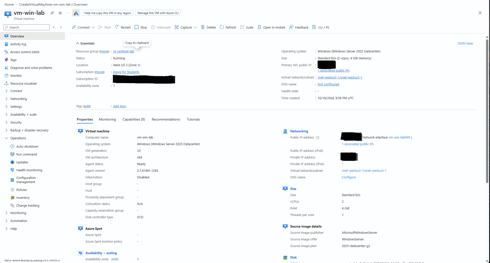

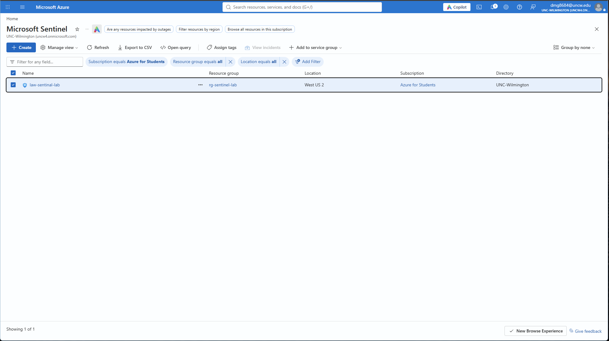

### Auditing setup

Audit policy commands run on the VM:

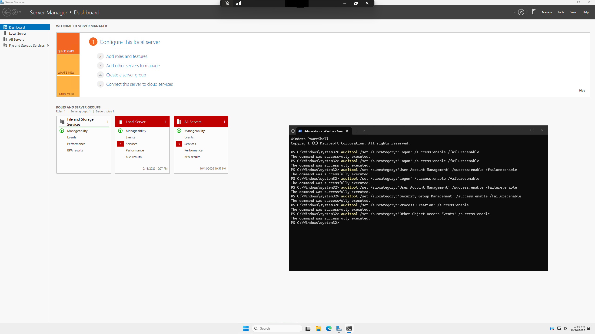

Resulting audit policy:

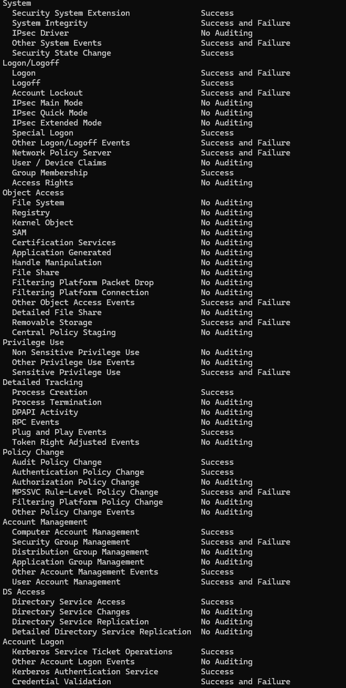

A process creation event (4688) in Event Viewer on the VM:

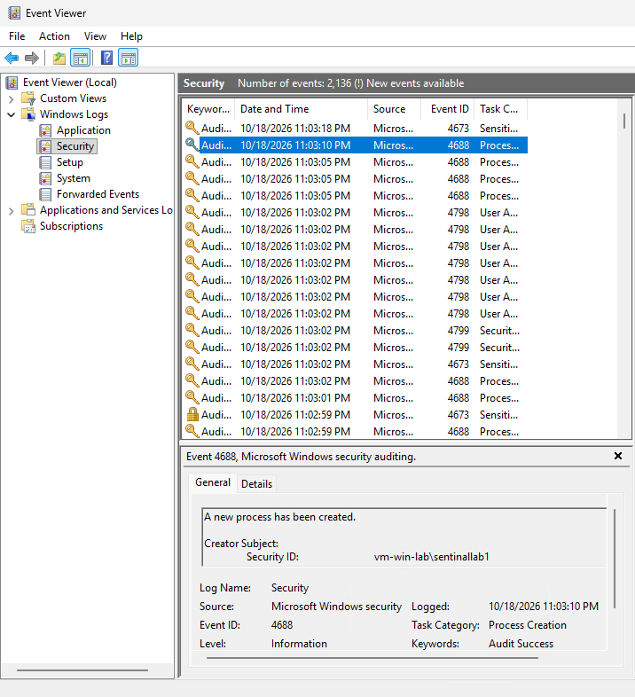

## Detections

| ID | Detection | MITRE ATT&CK | Event ID(s) | Query | Verified |
|---|---|---|---|---|---|
| D1 | Brute-force failed logons | T1110.001 | 4625 | [D1](detections/D1_bruteforce_failed_logons.kql) | ☐ |
| D2 | Password spray | T1110.003 | 4625 | [D2](detections/D2_password_spray.kql) | ✔ |
| D3 | Successful logon after repeated failures | T1110, T1078 | 4625, 4624 | [D3](detections/D3_success_after_failures.kql) | ☐ |
| D4 | Encoded PowerShell | T1059.001 | 4688 | [D4](detections/D4_encoded_powershell.kql) | ✔ |
| D5 | New local user created | T1136.001 | 4720 | [D5](detections/D5_new_local_user.kql) | ✔ |
| D6 | Account added to privileged group | T1098 | 4728, 4732, 4756 | [D6](detections/D6_added_to_privileged_group.kql) | ✔ |
| D7 | Scheduled task created | T1053.005 | 4698 | [D7](detections/D7_scheduled_task_created.kql) | ✔ |
| D8 | Security log cleared | T1070.001 | 1102 | [D8](detections/D8_security_log_cleared.kql) | ✔ |

D2 and D4 to D8 returned the expected rows in Sentinel. D1 and D3 were not confirmed (see Detection results).
Details for each detection (hypothesis, logic, false positives, tuning) are in [detection-catalog.md](detection-catalog.md).
The exact commands used to trigger each one are in [attack-simulation.md](attack-simulation.md).

## Results

### Data arriving in Sentinel

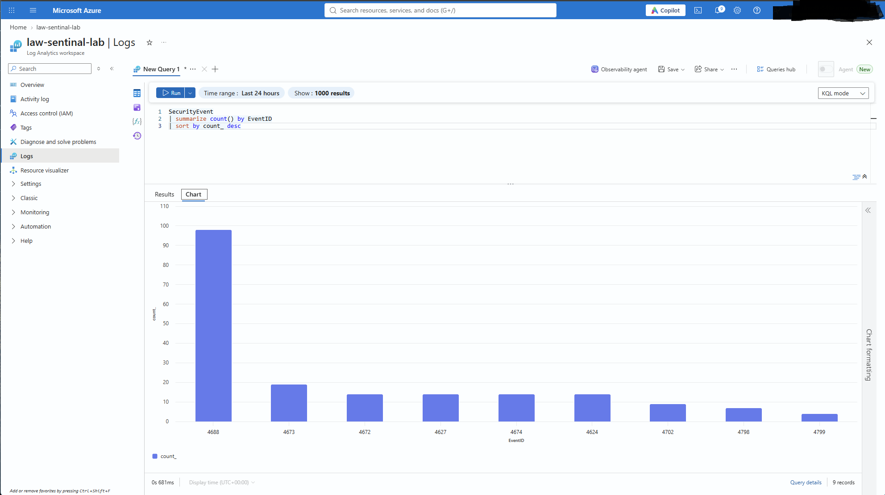

Sample rows from the `SecurityEvent` table:

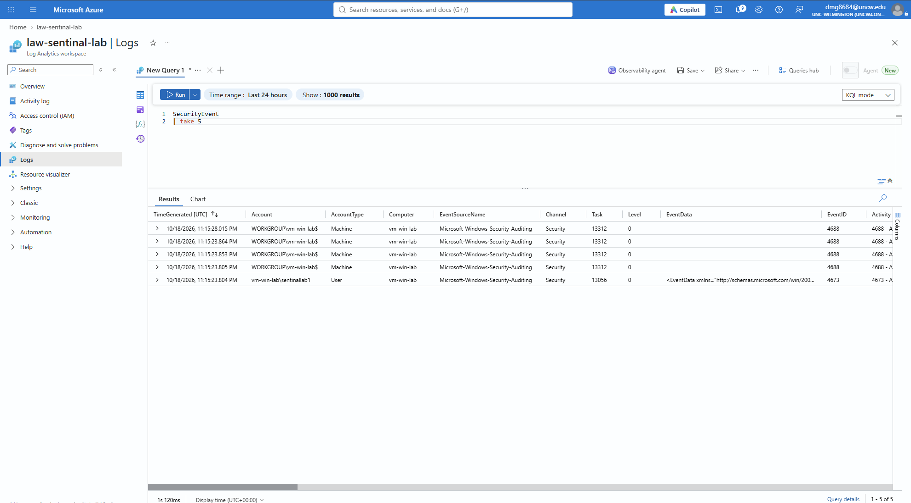

### Detection results

**D1 brute force: not confirmed.** The D1 query needs 5 failures per account, but Sentinel recorded only 2 of the 8 simulated failures for `labvictim`, so it returned no rows.

D1 simulation output (failed logins against `labvictim`):

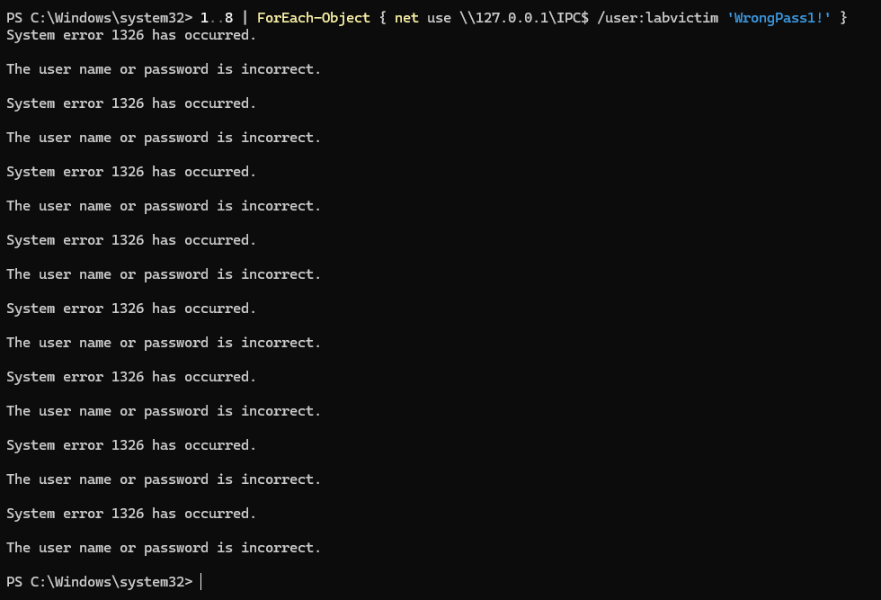

Failed-logon counts by account. `labvictim` shows only 2 recorded failures:

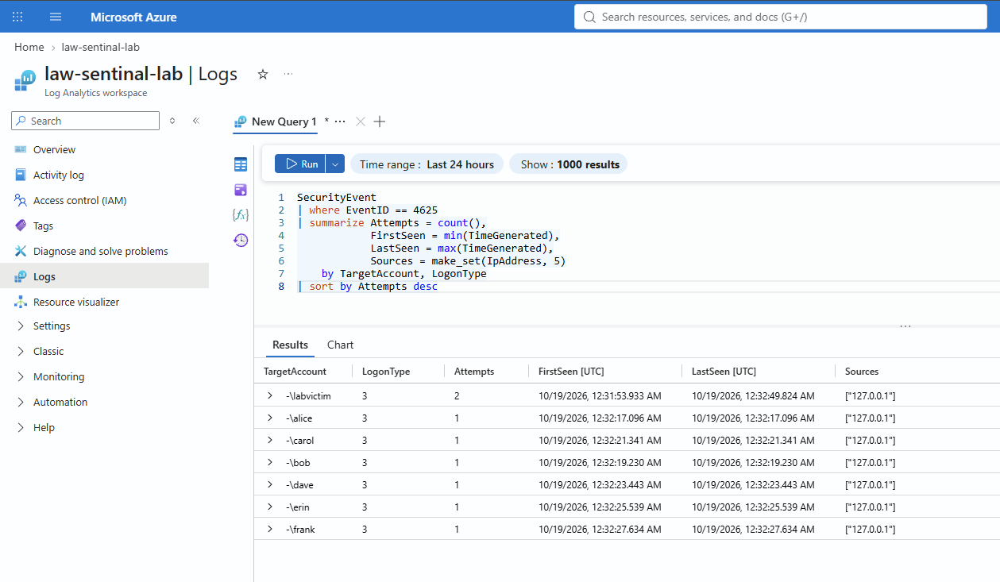

**D2 password spray: confirmed.** One row for 127.0.0.1 with 7 distinct accounts.

D2 simulation output (one failed login each for six account names):

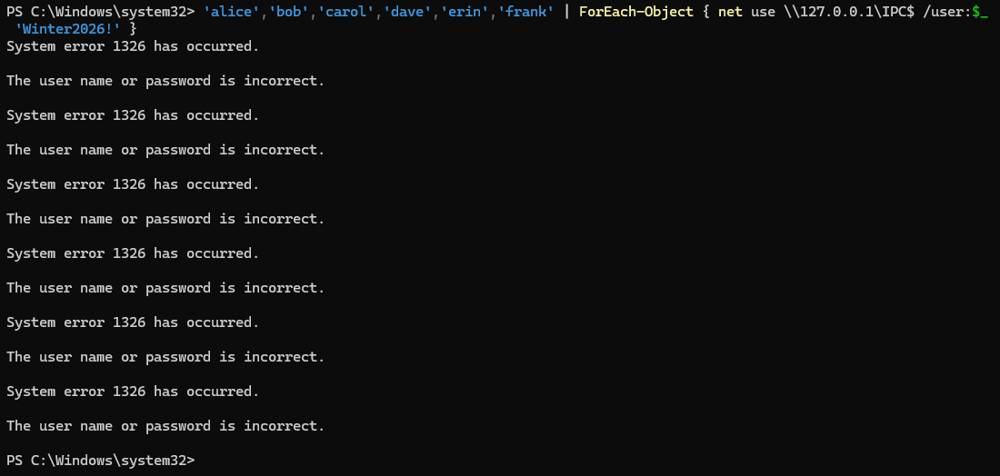

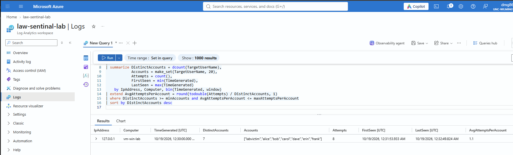

**D3 success after failures: not confirmed.** The final login used the literal placeholder text as the password, so it failed with system error 1326 and no successful logon followed the failures.

**D4 encoded PowerShell: confirmed.** One 4688 event with the encoded command line captured.

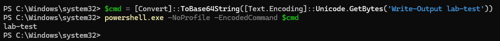

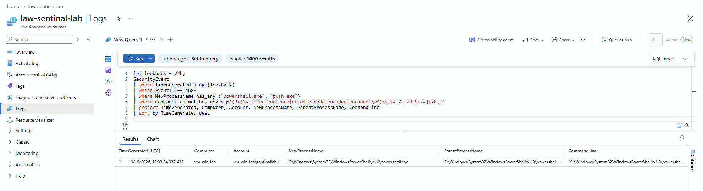

**D5 new local user and D6 added to Administrators: confirmed.** Each query returned the expected events.

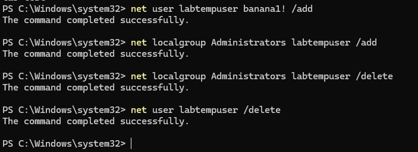

**D7 scheduled task created: confirmed.** One 4698 event for `\LabTestTask`.

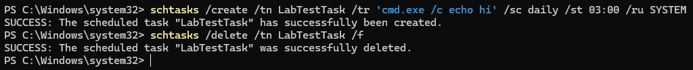

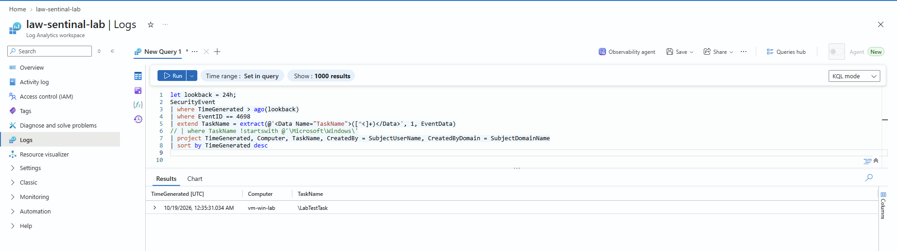

**D8 security log cleared: confirmed.** One 1102 event at the time the log was cleared.

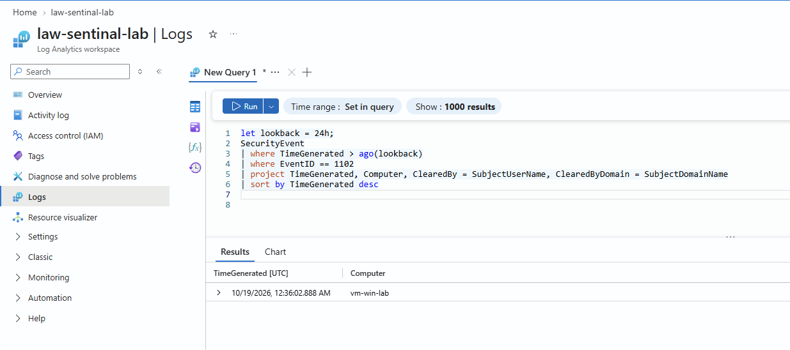

## Project status

- [x] Azure lab built (resource group, workspace, Windows Server VM)
- [x] Auditing configured and checked with `auditpol`
- [x] Sentinel enabled and Windows Security Events via AMA connected, with SecurityEvent data confirmed
- [x] D2 and D4 to D8 triggered and confirmed in Sentinel
- [x] D1 and D3 confirmed (see Detection results for why they were not)
- [x] Scheduled analytics rules created for each detection
- [x] False-positive tuning recorded in the catalog

## Lessons learned

- **Region policy blocked the workspace.** The student subscription rejected East US with `RequestDisallowedByAzure`. West US 2 passed validation. A resource group's own location did not matter, only the location of the resource inside it.
- **The firewall rule needed my public IP.** I first entered my PC's private 192.168.x.x address in the RDP rule, so nothing could connect. The rule must contain the public IPv4 address.
- **RDP needs the VM's local admin account.** Windows first offered my personal Microsoft account, which the VM does not know. Signing in as `.\username` fixed it.
- **Default auditing is not enough.** Scheduled task creation, process command lines, and account changes need audit policies turned on. I confirmed them with `auditpol` and enabled command-line capture in Group Policy.
- **Logs page details.** The Logs page opens in Simple mode, so KQL mode has to be selected. Queries also fail if the `let` lines at the top are left out when pasting.
- **Repeated identical failures were under-counted.** Eight identical failed logins against one account produced only 2 recorded failures, while single failures against six different accounts were all recorded. D1 may need distinct passwords or a short pause between attempts.
- **D3 needs a real successful login.** My success step used the placeholder text as the password, so no successful logon was recorded after the failures.
- **Windows creates its own scheduled tasks.** Event 4702 (task updated) appeared without any action from me, which suggests D7 will need an allowlist.

### Screenshots from troubleshooting

Azure policy rejecting the East US deployments:

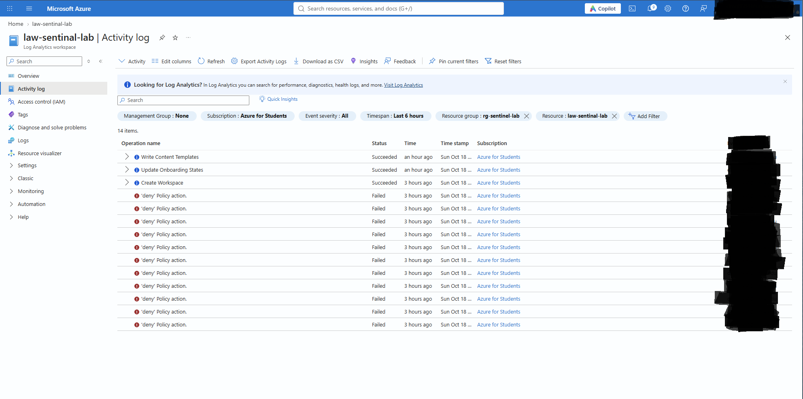

RDP rule with my PC's private address, which never matches:

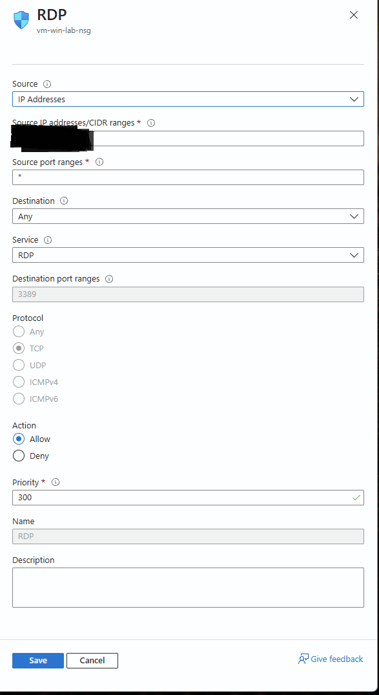

## Known limitations

- One VM and simulated attacks only, so there is no real adversary behavior.
- Simulated logins come from `127.0.0.1`, so source-IP logic is not realistic.
- The queries were written against the standard `SecurityEvent` columns. Column names or event formatting may differ by environment.
- Not production-ready. Thresholds are starting points and need tuning against real traffic.


## Reproduce the lab

- Beginner-friendly walkthrough: [SIMPLE_TUTORIAL.md](SIMPLE_TUTORIAL.md)
- Simulation commands: [attack-simulation.md](attack-simulation.md)
- Screenshot list: [docs/screenshot-checklist.md](docs/screenshot-checklist.md)

When finished, delete the resource group so nothing keeps billing.

## Repository structure

```
sentinel-detection-lab/
  README.md
  SIMPLE_TUTORIAL.md
  attack-simulation.md
  detection-catalog.md
  detections/        (D1 to D8, one .kql file each)
  docs/
    screenshot-checklist.md
    images/          (screenshots)
```

